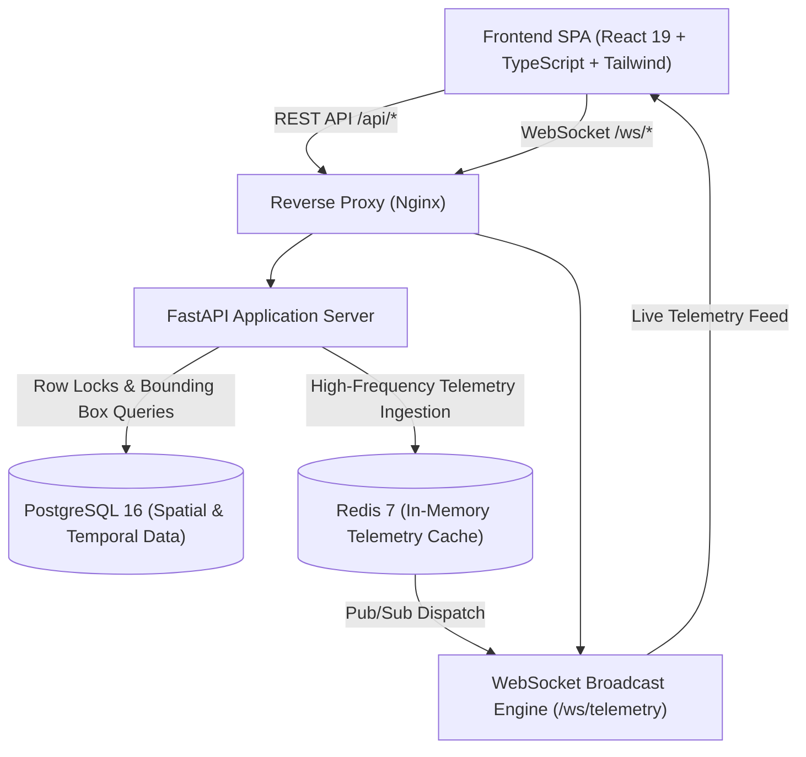

# UTM AEROSHIELD — Unmanned Flying Objects Traffic Management System

[](https://fastapi.tiangolo.com)
[](https://react.dev)
[](https://www.postgresql.org)
[](https://redis.io)
[](https://www.docker.com)
[](https://pytest.org)

UTM AEROSHIELD is an enterprise-grade, distributed Unmanned Aircraft System Traffic Management (UTM) platform designed for civil aviation authorities, fleet dispatchers, and commercial drone operators. The system coordinates conflict-free 4D airspace reservations, high-frequency flight telemetry streaming, regulatory compliance, and emergency flight corridor preemptions.

---

## Architecture Overview



---

## Contributor Attribution & Team Ownership

| Contributor | GitHub Identity | Modules & Core Ownership |
|---|---|---|
| **Anmol Saluja** | `@Anmol4679` | Repository Monorepo Architecture, Identity, RBAC, JWT Security, Polymorphic Fleet Management, Shared App Shell |
| **Shravan2307** | `@Shravan2307` | Airspace Sectors, 4D Time-Slot Reservations, Concurrency Engine (`SELECT FOR UPDATE`), Emergency Preemption, Radar Map (`/telemetry`), Regulator Console (`/regulator`), Test Suites, Dockerization & CI |
| **Shlok Vyas** | `@shlokvyas45` | Real-Time Telemetry Ingestion, Redis Caching, WebSocket Broadcast Server (`/ws/telemetry`), Telemetry Schema |

---

## Core System Modules

### 1. Identity, Authentication & Role-Based Access Control (RBAC)
- **Role Hierarchy**: `CIVIL_AVIATION_REGULATOR`, `FLEET_OPERATOR`, `DISPATCHER`.
- **Authentication**: JWT Bearer Tokens with expiration and sliding window refresh.
- **Security**: Direct `bcrypt` password hashing, SlowAPI rate-limiting (5 login requests/min), immutable `AuditLog` recording.

### 2. Fleet Management & Polymorphic Drone Subtypes
- **Joined-Table Inheritance**: Base `Drone` model extended into `DroneQuadcopter`, `DroneFixedWing`, and `DroneEmergencyMedical`.
- **Fleet Controls**: Real-time status tracking (`IDLE`, `IN_FLIGHT`, `MAINTENANCE`), battery level monitoring, and operator-isolated fleet viewing.

### 3. 4D Airspace Reservation & High-Concurrency Locking
- **Spatial Sectors**: Airspace defined by 3D bounding boxes (`min_lat`, `max_lat`, `min_lon`, `max_lon`, `floor_altitude_m`, `ceiling_altitude_m`) indexed with GiST spatial indexes.
- **Temporal Windows**: Discrete 30-minute reservation slots indexed with composite B+Tree `(sector_id, start_time, end_time)`.
- **Pessimistic Concurrency**: Row-level locking via `SELECT ... FOR UPDATE` ensuring zero race conditions or double-bookings under concurrent loads (`HTTP 409 Conflict`).
- **Emergency Preemption**: Regulators can instantly elevate emergency medical flights to `CRITICAL` priority, automatically displacing conflicting `STANDARD` flights and logging the security event.

### 4. Real-Time Telemetry, WebSocket Feeds & Radar Dashboard
- **Telemetry Ingestion**: Ingests GPS latitude, longitude, altitude (AGL), speed, heading, and battery percentage into Redis 7 hash sets with in-memory fallback.
- **Full-Duplex WebSockets**: `/ws/telemetry` pushes instantaneous telemetry updates to all active visualizer clients.
- **Dark Aerospace Radar Map**: Custom SVG radar map with dynamic range rings, sector boundaries, aircraft heading rotation, and glowing flight breadcrumbs.
- **HUD & Alarms**: Heads-Up Display featuring altitude gauges, ground speedometers, compass heading, and automatic breach alarms (>120m ceiling violations, geofence breaches, low battery).
- **Flight Simulator**: Built-in interactive flight simulator allowing live testing without physical hardware.

### 5. Regulator Airspace Console & Audit Trail
- **Operator Governance**: Civil aviation regulators can view all registered operators and toggle immediate license suspensions.
- **Security Audit Trail**: Searchable, filterable ledger recording all critical system actions (`CANCEL_RESERVATION`, `EMERGENCY_PREEMPT`, `SUSPEND_OPERATOR`, `LOGIN`) with one-click CSV export.

---

## Technology Stack

- **Backend**: Python 3.11+ / 3.12 / 3.14, FastAPI, SQLAlchemy 2.0, Alembic, psycopg3, Redis 7, Pydantic v2, SlowAPI, Pytest, HTTPX.
- **Frontend**: React 19, TypeScript, Vite, Tailwind CSS, Lucide React, React Router v7.
- **DevOps & Infrastructure**: Docker, Docker Compose, Nginx, GitHub Actions CI.

---

## Quickstart Guide

### Option A: Running with Docker Compose (Recommended)

Start all services (PostgreSQL 16, Redis 7, FastAPI Backend, React 19 Frontend + Nginx):

```bash
docker compose up --build -d
```

Access the applications:
- **Web UI & Dashboard**: [http://localhost:80](http://localhost:80)
- **FastAPI Interactive Docs**: [http://localhost:80/api/docs](http://localhost:80/api/docs) or [http://localhost:8000/docs](http://localhost:8000/docs)
- **WebSocket Telemetry Stream**: `ws://localhost:80/ws/telemetry`

To stop the containers:
```bash
docker compose down
```

---

### Option B: Local Manual Setup

#### 1. Backend Setup

```bash
cd backend
python -m venv venv
# On Windows:
.\venv\Scripts\activate
# On Linux/macOS:
source venv/bin/activate

pip install -r requirements.txt
```

Configure `.env` (or use built-in SQLite & in-memory Redis fallback):
```bash
cp .env.example .env
```

Run database migrations:
```bash
python -m alembic upgrade head
```

Seed initial airspace sectors and flight slots:
```bash
python seed_reservations.py
```

Start the FastAPI ASGI server:
```bash
uvicorn main:app --host 127.0.0.1 --port 8000 --reload
```

#### 2. Frontend Setup

```bash
cd frontend
npm install
npm run dev
```

Visit [http://localhost:5173](http://localhost:5173).

---

## Demo Credentials

The backend automatically seeds demo operator accounts on startup if not present:

| Role | License Number | Password | Capabilities |
|---|---|---|---|
| **Civil Aviation Regulator** | `LIC-REG-001` | `Regulator@123` | Full airspace oversight, emergency preemption, operator suspension, audit trail |
| **Fleet Operator** | `LIC-FLEET-001` | `Fleet@123` | Drone registration, airspace booking, telemetry viewer |
| **Dispatcher** | `LIC-DISP-001` | `Dispatcher@123` | High-priority flight routing, schedule management |

*Note: The login screen also features 1-Click Demo Login buttons for instant access.*

---

## Automated Test Suites

Run the complete backend test suite (unit tests, integration tests, concurrency tests, and WebSocket connections):

```bash
cd backend
pytest tests/ -v
```

Expected result:
```text
======================= 27 passed, 14 warnings in 0.58s =======================
```

To run the live concurrency stress test (simulates 50 simultaneous booking requests on the same slot):
```bash
python tests/concurrency_test.py --url http://127.0.0.1:8000 --slot-id 1 --token <JWT_TOKEN> --drone-id 1 --requests 50
```

---

## API Endpoints Reference

### Identity & Authentication
- `POST /api/auth/register` — Register a new operator.
- `POST /api/auth/login` — Authenticate and obtain JWT bearer token (rate-limited).
- `GET /api/auth/me` — Retrieve current authenticated operator profile.
- `GET /api/operators` — List all registered operators (Regulator only).
- `PATCH /api/operators/{id}/suspend` — Suspend or reinstate operator license.
- `GET /api/audit-log` — Retrieve immutable audit trail log.

### Fleet Management
- `GET /api/drones` — List drones belonging to current operator.
- `POST /api/drones` — Register a polymorphic drone (`QUADCOPTER`, `FIXED_WING`, `EMERGENCY_MEDICAL`).
- `GET /api/drones/{id}` — Retrieve drone technical details and status.
- `PATCH /api/drones/{id}/status` — Update drone operational status.

### Airspace Reservations & Preemption
- `GET /api/sectors` — List all 3D airspace sectors with bounding coordinates.
- `GET /api/sectors/{sector_id}/availability` — Query 30-minute time slots in a datetime window.
- `POST /api/reservations` — Book a slot with row-level locking (`SELECT ... FOR UPDATE`).
- `GET /api/reservations/mine` — Retrieve current operator's reservations.
- `DELETE /api/reservations/{reservation_id}` — Atomically cancel a reservation and release the slot.
- `POST /api/reservations/{reservation_id}/emergency-preempt` — Regulator emergency corridor override.

### Telemetry & WebSocket Streaming
- `POST /api/telemetry` — Ingest high-frequency telemetry metrics into Redis.
- `GET /api/telemetry` — Retrieve latest telemetry snapshots for all active drones.
- `GET /api/telemetry/{drone_id}` — Retrieve latest coordinates and status for a drone.
- `WS /ws/telemetry` — Full-duplex WebSocket stream broadcasting live telemetry packets.

---

## License

Developed under the Unmanned Flying Objects Traffic Management System initiative. All rights reserved.
