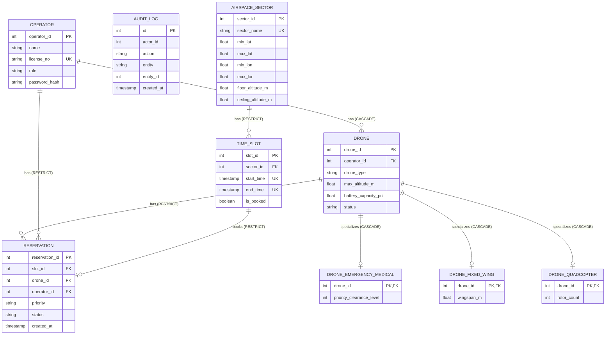

# Entity-Relationship Diagram (ERD) & Enhanced ER (EER) Specification

This document details the relational architecture of the **Unmanned Flying Objects Traffic Management System (UTM)** database (`utm_drone_db`), generated directly from the live PostgreSQL instance using the SQLAlchemy inspector (`backend/scripts/dump_schema.py`).

---

## 1. Relational Schema ERD (Mermaid)



> **Pending Teammate Tables**:
> - `waypoint_telemetry` (Owned by teammate Shlok - Telemetry / Redis + InfluxDB time-series ingestion; not instantiated in PostgreSQL).

---

## 2. Enhanced Entity-Relationship (EER) Specialization: Drone Hierarchy

### 2.1 Specialization Structure
The airspace platform models unmanned aerial vehicles (UAVs) using Joined Table Inheritance (also known as Class Table Inheritance):
- **Superclass**: `drone` (contains common attributes: operational limits, telemetry status, ownership).
- **Subclasses**:
  - `drone_fixed_wing`: Specialized for long-range, aerodynamic flights with attribute `wingspan_m`.
  - `drone_quadcopter`: Specialized for vertical takeoff/hover with attribute `rotor_count`.
  - `drone_emergency_medical`: Specialized for rapid medical/organ transport with attribute `priority_clearance_level`.

### 2.2 Formal Constraints
1. **DISJOINT (d)**: An aircraft instance can belong to **at most one** subtype. A fixed-wing drone cannot simultaneously be a quadcopter or an emergency medical drone.
2. **TOTAL (t)**: **Every** base drone in the airspace system must belong to **at least one** subtype. Generic or unclassified drones are forbidden.
3. **Discriminator**: The `drone.drone_type` column acts as the explicit type discriminator:
   - Valid values: `'FIXED_WING'`, `'QUADCOPTER'`, `'EMERGENCY_MEDICAL'`.
   - Enforced by PostgreSQL CHECK constraint: `drone_drone_type_check: drone_type IN ('FIXED_WING', 'QUADCOPTER', 'EMERGENCY_MEDICAL')`.

### 2.3 Shared Primary Key Mapping
Subtype tables do not allocate independent surrogate keys. Instead, they use a **Shared Primary Key**:
- Subtype table primary key is `drone_id`.
- `drone_id` is concurrently a Foreign Key pointing to `drone(drone_id)`:
  ```sql
  CONSTRAINT drone_fixed_wing_pkey PRIMARY KEY (drone_id),
  CONSTRAINT drone_fixed_wing_drone_id_fkey FOREIGN KEY (drone_id) 
      REFERENCES drone (drone_id) ON DELETE CASCADE
  ```
- **Benefits**:
  - Eliminates redundant index storage for secondary surrogate keys.
  - Automatically guarantees that no two subtype rows can point to the same base drone row.
  - Natural 1:1 join relationship on primary keys.
  - Cascade deletion (`ON DELETE CASCADE`) ensures that decommissioning a base drone automatically purges its subtype specification row with zero orphan leaks.

### 2.4 How the Constraints are Enforced
1. **Disjointness**:
   - `CHECK (drone_type IN ('FIXED_WING', 'QUADCOPTER', 'EMERGENCY_MEDICAL'))` on the base table.
   - Application registration logic selects the exact subtype table corresponding to `drone_type`.
   - Because `drone_id` in each subtype table is a `PRIMARY KEY`, a drone cannot have duplicate rows in the same subtype.
2. **Atomicity & Transaction Boundary**:
   - Drone creation and subtype record insertion are executed in a single atomic database transaction using SQLAlchemy (`with db.begin_nested():` / `db.commit()`).
   - If subtype validation or insertion fails, the entire transaction (or savepoint) immediately rolls back, guaranteeing that no base `drone` record exists without its subtype record.

### 2.5 Honest Architectural Limitation & Stricter Alternative
- **The Limitation**:
  In standard ANSI SQL and PostgreSQL declarative DDL, a foreign key constraint can only reference an already existing row in the referenced table. When inserting a new drone:
  1. Step 1: Base row `drone` must be inserted.
  2. Step 2: Subtype row `drone_fixed_wing` is inserted with FK pointing to `drone_id`.
  
  Therefore, between Step 1 and Step 2 within a transaction, or if a raw `INSERT INTO drone` is executed directly via SQL client without inserting a subtype row, **the database engine alone cannot prevent an orphan base drone from existing**.
- **Stricter Database-Side Alternative**:
  To enforce **TOTAL specialization strictly at the database engine level**, the database would require a **Deferrable Constraint Trigger**:
  ```sql
  CREATE OR REPLACE FUNCTION check_drone_total_specialization() 
  RETURNS TRIGGER AS $$
  BEGIN
      IF NOT EXISTS (
          SELECT 1 FROM drone_fixed_wing WHERE drone_id = NEW.drone_id
          UNION ALL
          SELECT 1 FROM drone_quadcopter WHERE drone_id = NEW.drone_id
          UNION ALL
          SELECT 1 FROM drone_emergency_medical WHERE drone_id = NEW.drone_id
      ) THEN
          RAISE EXCEPTION 'Total specialization violation: drone % has no subtype record', NEW.drone_id;
      END IF;
      RETURN NEW;
  END;
  $$ LANGUAGE plpgsql;

  CREATE CONSTRAINT TRIGGER trg_drone_total_specialization
  AFTER INSERT ON drone
  DEFERRABLE INITIALLY DEFERRED
  FOR EACH ROW
  EXECUTE FUNCTION check_drone_total_specialization();
  ```
  With this trigger, PostgreSQL defers verification until `COMMIT`. If a transaction attempts to commit a base `drone` without having inserted exactly one subtype row in the same transaction, PostgreSQL aborts and rolls back the commit automatically.
